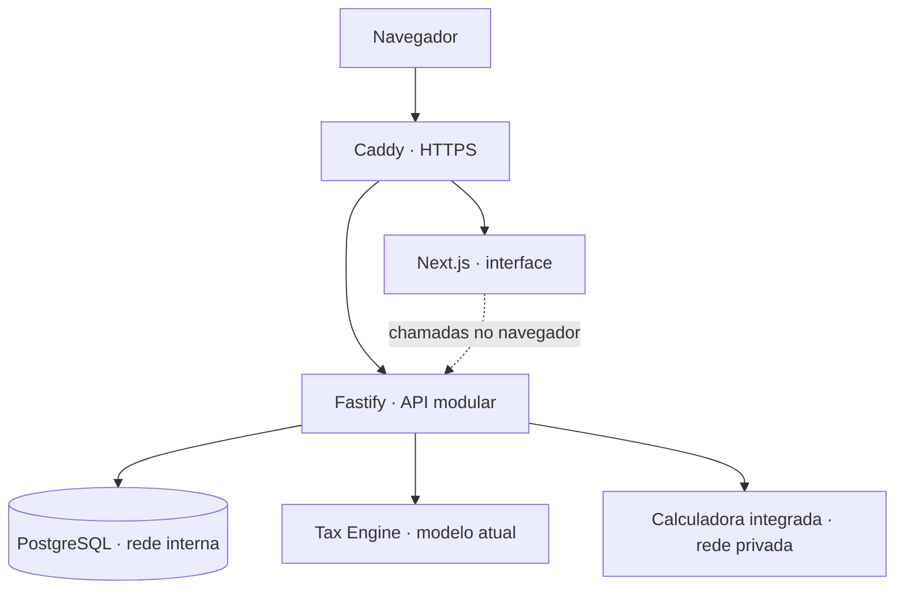

# TaxSim — comparação tributária demonstrativa

Compare o modelo atual (PIS/COFINS/ICMS/ISS) com IBS/CBS/IS em uma aplicação
full-stack multi-tenant. Projeto de portfólio de [Mitsrael](https://github.com/M-its),
com motor decimal, integração externa validada, recuperação de sessão e testes
de acessibilidade.

[Experimentar a demonstração](https://taxsim-web.duckdns.org) ·
[Escopo e estado do release](./ROADMAP.md) · [Arquitetura](./docs/PROJECT_CONTEXT.md)

> Projeto de demonstração técnica, sem vínculo com a Receita Federal. Não deve
> ser usado para cálculos fiscais reais. A branch de fechamento ainda não
> representa uma v1.0 publicada; a demo pode executar uma revisão anterior.

## Sumário

- [Produto e fluxo principal](#produto-e-fluxo-principal)
- [Arquitetura](#arquitetura)
- [Decisões de engenharia](#decisões-de-engenharia)
- [Segurança e sessão](#segurança-e-sessão)
- [Acessibilidade e descoberta](#acessibilidade-e-descoberta)
- [Executar localmente](#executar-localmente)
- [Verificações](#verificações)
- [Limitações](#limitações)
- [Documentação e estrutura](#documentação-e-estrutura)
- [Autoria e licença](#autoria-e-licença)

## Produto e fluxo principal

1. Cadastre uma empresa de demonstração; não há conta pública compartilhada.
2. Crie produtos e clientes ou use NCM manual na simulação.
3. Compare os tributos dos dois modelos; todos os bloqueios por item aparecem
   juntos e os dados preenchidos são preservados para correção.
4. Crie uma venda DRAFT e confirme/cancele conforme o estado permitido. O
   dashboard agrega vendas confirmadas e oferece gráficos com dados textuais.

A busca de NCM combina prefixo de código e substring de descrição sem diferença
de caixa/acentos. NCM vigente sem regra continua visível, marcado como bloqueador
na simulação. Formato, existência, vigência e regra são diagnósticos diferentes;
falha técnica de consulta não é tratada como prova de código inválido.

CNPJ numérico e alfanumérico têm máscara progressiva, normalização e DV; CPF
permanece numérico. Unicidade de produtos/clientes é por empresa. Configurações
permitem editar dados fiscais da empresa; onboarding pode ser reaberto pelo tour.

A landing mostra notebook/NCM 84713012, 1 × R$ 1.000, Lucro Real: R$ 272,50 no
modelo atual e R$ 10,00 na resposta reformada **sintética**. Fixture versionada,
elegibilidade compartilhada e teste mantêm a prova coerente com o código. Não
é chamada à RFB, promessa de economia ou cálculo fiscal válido.

## Arquitetura



Aplicação e calculadora são separadas por compatibilidade ARM/x86. A stack de
produção publica somente o proxy em 80/443; Web/API/banco não têm portas
publicadas. Configuração real de rede e evidências operacionais são privadas.

**Web:** Next.js 15.5, React 19, TypeScript, Tailwind v4, Base UI/shadcn,
Recharts, Framer Motion e driver.js. Landing usa componentes de servidor com
ilhas interativas; o app usa hooks consumindo REST no navegador.

**API:** Fastify, Zod, Prisma e PostgreSQL 16. Motor atual puro, sem Prisma/HTTP,
com aritmética decimal; adaptador separado para a calculadora disponibilizada
pela RFB. Após elegibilidade, o fluxo executa o motor atual e então aguarda o
modelo reformado. Só persiste a venda após validar e combinar as respostas.

**Entrega:** Docker Compose, Caddy/TLS e GitHub Actions. pnpm 10.17.1 e Node 22
na CI. Hospedagem demonstrativa em camada gratuita não é garantia de custo ou
SLA futuro.

## Decisões de engenharia

- **Monólito modular:** separa domínio, transporte e persistência sem adicionar
  coordenação de microserviços ao escopo do portfólio.
- **Multi-tenancy na aplicação:** tenant vem do JWT; consultas e verificações
  de propriedade antecedem mutações por ID. Itens herdam a venda pai. Banco
  compartilhado sem RLS: exige disciplina e testes de isolamento.
- **Decimal e snapshots:** valores monetários não usam ponto flutuante;
  preço/NCM/alíquotas são congelados ao criar a venda, não recalculados quando
  o produto muda. Precisões de valores e alíquotas são distintas no Prisma.
- **Contrato externo desconfiado:** schema runtime, correlação bijetiva por item
  e reconciliação de totais antes de usar a resposta; não confiar na ordem ou
  somente em HTTP 200. Timeout/circuit breaker não inventam resultado fiscal.
- **Catálogo não é regra:** NCM válido pode ser cadastrado sem estar elegível
  para simular. A validação final do backend continua obrigatória.
- **Falha de rede não é logout:** restauração limitada e recuperável mantém
  formulário e ações públicas disponíveis, sem exibir conteúdo privado antes
  da confirmação da sessão.

Um caso de debugging que orientou a integração: datas com sufixo UTC `Z` eram
rejeitadas pela versão integrada da calculadora, que exigia offset explícito.
As respostas inválidas acabavam abrindo o circuit breaker e escondendo a causa
atrás de indisponibilidade rápida. O adaptador e seus testes tratam o formato;
o breaker não substitui diagnóstico e validação de contrato.

## Segurança e sessão

- JWT de acesso em memória, com validade de 15 minutos; não armazenado em
  localStorage. Isso reduz persistência do token, não torna a aplicação imune a XSS.
- Refresh HttpOnly de sete dias, rotacionado atomicamente e armazenado somente
  como HMAC-SHA-256 com pepper externo. Reuso detectado revoga sessões do usuário.
- Produção: `Secure; SameSite=None; Path=/auth`. Os sites Web/API separados
  exigem None; Path inclui refresh e logout. [Motivo e limites](./docs/API_CONTRACTS.md#autenticação-e-cookie).
  CORS explícito com credenciais é necessário; não há token anti-CSRF dedicado,
  e cookies de terceiros podem ser bloqueados pelo navegador.
- Logout comum revoga o refresh apresentado; logout global é separado. JWTs
  de acesso emitidos não têm denylist e podem durar até expirar.
- Segredos obrigatórios falham no startup; login/cadastro têm rate limiting
  no Fastify. Origem de redirects pós-login passa por allowlist local.
- Payloads monetários rejeitam expoentes/valores fora do domínio. Erros de CNPJ
  expõem mensagem genérica, sem distinguir DV de duplicidade na interface;
  isso não promete indistinguibilidade de todos os status HTTP.

Restauração de sessão tem limite de oito segundos e retry manual de refresh;
apenas a leitura transitória de `me()` pode repetir uma vez sem refresh
indireto. Respostas tardias não substituem sessão mais recente. Rotas privadas
mostram recuperação em falha técnica e pedem login quando a sessão é inválida.
O CTA principal da landing permanece disponível e estável; dashboard é secundário.

## Acessibilidade e descoberta

Skip link, nomes acessíveis, erros inline/resumo/foco no primeiro campo inválido,
status assíncronos, navegação por teclado, foco de overlays, alternativa textual
a gráficos e `prefers-reduced-motion`. Confirmações inline não expiram por tempo.
O baseline manual anterior foi aceito pelo responsável; alterações posteriores
continuam sujeitas a revisão manual antes de integração. Não é certificação WCAG.

Playwright/axe cobre login, cadastro, simulação, produtos, clientes, vendas e
componentes compartilhados em Chromium desktop/móvel. Sérios/críticos e falhas
obrigatórias de teclado fazem o job falhar; a branch deve exigir o check para
bloquear merge. [Processo e matriz manual](./docs/runbooks/accessibility-regression-tests.md).

Somente a landing recebe sitemap, canonical, OG/Twitter e JSON-LD público.
Login/cadastro e rotas privadas são noindex e não compartilham dados do tenant
em metadados. Manifest e ícones TS são informativos: sem service worker ou
promessa de uso offline. Metadados produtivos ainda exigem smoke após deploy.

## Executar localmente

Pré-requisitos: Docker/Compose, Node 22, pnpm 10.17.1 e o arquivo da calculadora
obtido de sua distribuição oficial. A imagem x86 pode exigir máquina compatível;
para testes automatizados existe calculadora determinística, não um serviço fiscal.

```bash
git clone https://github.com/M-its/taxsim.git
cd taxsim
cp .env.example .env
# Configure valores locais; nunca reutilize segredos de produção.
docker import calculadora.tar.gz calculadora-image
./scripts/dev-up.sh
```

Na primeira instalação **local e descartável**, após revisar a configuração:

```bash
docker compose exec api pnpm exec prisma migrate deploy
docker compose exec api pnpm exec prisma db seed
docker compose exec api pnpm run import:ncm
```

Web: `http://localhost:3000`; saúde da API: `http://localhost:3333/health`.
O script de desenvolvimento recria API/Web preservando o volume do banco. Não
executar seed/import/reset indiscriminadamente contra ambientes com dados reais.

Use `.env.example` como referência de variáveis; JWT, senha do banco e pepper
são valores gerados fora do Git. O compose também exige `NEXTAUTH_SECRET`,
ainda que o fluxo atual use autenticação própria. O build do Web embute
`NEXT_PUBLIC_API_URL`: mudança dessa origem exige rebuild, não só restart.

## Verificações

Instale dependências em cada aplicação com seu lockfile versionado; para API,
gere o Prisma Client antes do typecheck. Não substitua os lockfiles das apps
pelo arquivo raiz nem sincronize ambientes de produção para executar testes.

```bash
pnpm --dir apps/api install --frozen-lockfile
pnpm --dir apps/web install --frozen-lockfile
pnpm --dir apps/api exec prisma generate
pnpm --dir apps/api exec vitest run
pnpm --dir apps/web exec vitest run
pnpm --dir apps/api exec tsc --noEmit
pnpm --dir apps/web exec tsc --noEmit
pnpm --dir apps/web exec eslint .
./scripts/a11y-test.sh
```

CI em push para main/release e PR para main: testes, typecheck API/Web, lint Web
(somente erros bloqueiam) e suíte acessível descartável. O lint ignora artefatos
gerados, não fonte/testes/scripts. A suíte acessível prepara banco exclusivo e
calculadora mock; nunca depende da demo ou RFB real. Deploy não é automático.

Performance, a partir de `apps/web` (substituir placeholders):
`node scripts/performance-audit.mjs --build=<BUILD_ISOLADO> --tools=<FERRAMENTAS> --output=<RELATORIOS_FORA_DO_CHECKOUT> --phase=before`.
Preparar build standalone separado com `NEXT_PUBLIC_API_URL=http://localhost:3339`,
Lighthouse 12.8.2 em diretório de ferramentas privado e Chromium do Playwright.
Não usar o cache `.next` de um `next dev` em execução. O script inicia API
sintética e servidor somente em loopback; relatórios devem ficar fora do checkout.

## Limitações

- **Uso fiscal:** catálogo/regras limitados e versionados manualmente. Não há
  resolução universal por CST/cClassTrib, CFOP, benefícios ou operações especiais.
  A integração RFB não garante atualidade jurídica nem cálculo fiscal válido.
  [Escopo fiscal detalhado](./docs/limitacoes-fiscais-e-classificacao.md).
- **Localização:** simulação avulsa usa município/UF didáticos fixos; venda
  persistida usa a configuração da empresa. Não interpretar os fluxos como
  equivalentes a uma apuração por operação real.
- **Dependências e segurança:** demo sem SLA; simulação depende da calculadora.
  Sem RLS, RBAC avançado, denylist de JWT, token anti-CSRF dedicado ou auditoria
  completa de operações. Endpoint auxiliar de municípios ainda tem dependência
  de endereço fixo no código; cadastro solicita código IBGE e UF manualmente.
- **Performance — medido:** em 14/10/2026, medianas de três execuções Lighthouse
  por página/perfil: **desktop 100/99/92**, **móvel simulado 86/82/59**, na ordem
  landing/login/dashboard. **Metas móveis de LCP, TBT e pontuação não atingidas**.
  Móvel: LCP 2,80/3,40/4,52 s e TBT 409/352/1.408 ms. Metas: LCP ≤ 2,5 s,
  TBT ≤ 200 ms, pontuação ≥ 90 públicas e ≥ 80 dashboard. CLS e orçamentos de
  transferência JS/fontes/imagens ficaram dentro dos limites nesta amostra.
  Build de produção local, cache HTTP frio, dashboard preenchido com fixture,
  API sintética com 100 ms, móvel 390 × 844 com CPU 4× e rede simulada;
  não são métricas reais de usuários ou do servidor produtivo. Amostra pequena,
  sem INP de campo; um experimento sem ganho consistente foi revertido.
- **Backlog pós-v1.0 de performance:** (1) perfilar scripting/hidratação móvel,
  especialmente dashboard/Recharts; (2) avaliar carregamento tardio de gráficos
  e tour com espaço reservado/alternativa textual e regressões; (3) revisar
  preloads de fontes não usados no login. São oportunidades a validar, não
  ganhos garantidos nem mudanças já implementadas. Sem gate Lighthouse ou
  monitoramento periódico nesta entrega.
- **Fora da v1.0:** Split Payment operacional, NF-e, PSPs, conciliação,
  atualização automática NCM, métricas de tráfego real e novo redesign amplo.
  Campos/modelos de fundação não significam integração financeira disponível.

## Documentação e estrutura

- [ROADMAP](./ROADMAP.md): estado de fechamento, critérios de release e backlog.
- [Contexto de arquitetura](./docs/PROJECT_CONTEXT.md): decisões efetivas.
- [Contratos REST](./docs/API_CONTRACTS.md): endpoints, sessão e diagnósticos.
- [Limites fiscais](./docs/limitacoes-fiscais-e-classificacao.md).
- Runbooks: [deploy/rollback](./docs/runbooks/release-deploy-rollback.md),
  [rede OCI](./docs/runbooks/oci-firewall.md),
  [acessibilidade](./docs/runbooks/accessibility-regression-tests.md).
- [AGENTS](./AGENTS.md): responsabilidades e workflow de colaboração.

`apps/api` contém Prisma e módulos de domínio; `apps/web` contém rotas,
componentes, hooks e testes; `scripts` contém comandos operacionais/rede e a
stack acessível descartável. Contratos e contexto públicos ficam em `docs/`.
Históricos de auditoria, estudo, entrevista, logs de decisão e configurações
locais de agentes não integram a árvore pública atual. O histórico Git anterior
não é apagado pela retirada de arquivos do índice.

## Autoria e licença

Mitsrael mantém requisitos, arquitetura, revisão e aceite. Ferramentas de IA
apoiam análise, implementação e testes, sem substituir responsabilidade humana
ou provar revisão manual das mudanças ainda locais. Detalhes em [AGENTS](./AGENTS.md).

MIT — [LICENSE](./LICENSE).
